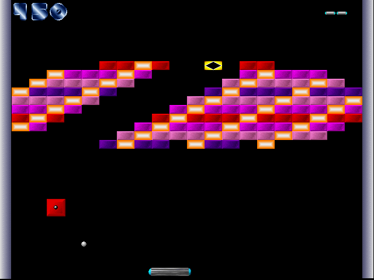
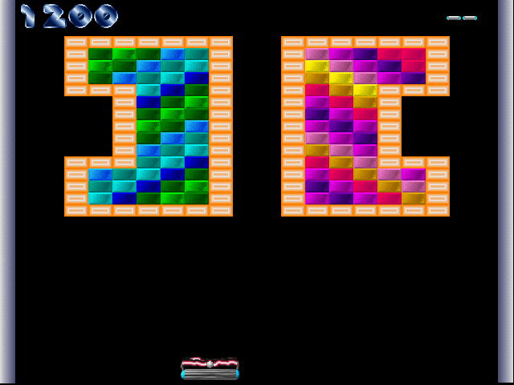
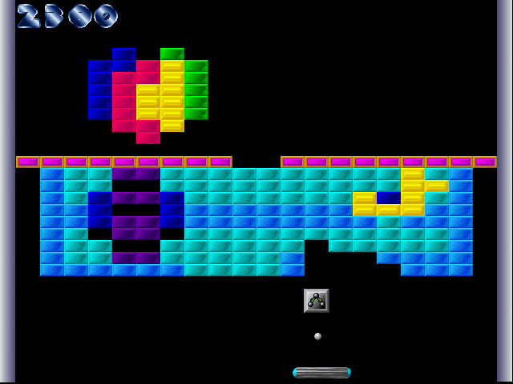

# DxBallJS

An open source reimplementation of the original DxBall game in pure javascript.

You can play the game on the following link:

https://szjoakim93.github.io/DxBallJS

You can also play the game by downloading all files from the repository and launching index.html

